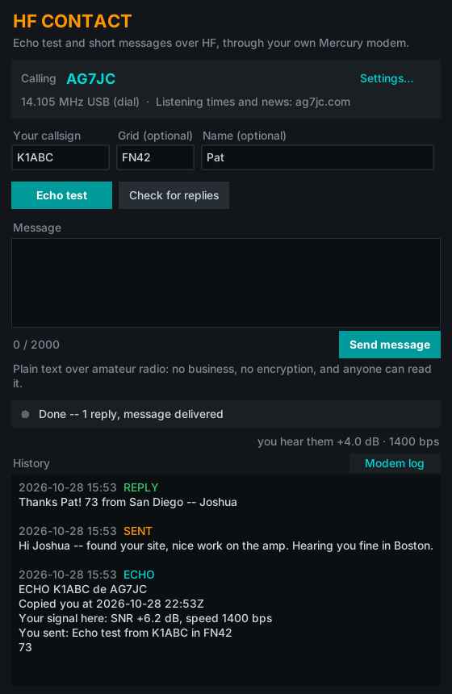
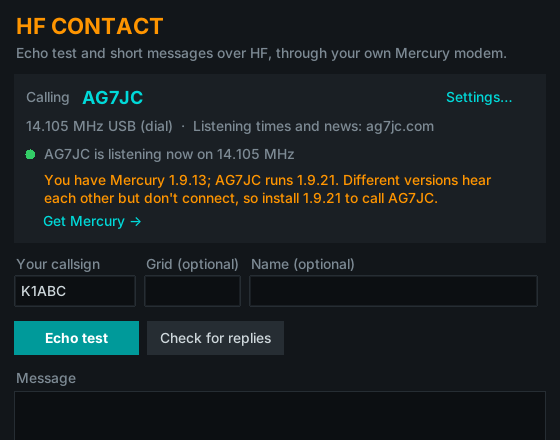
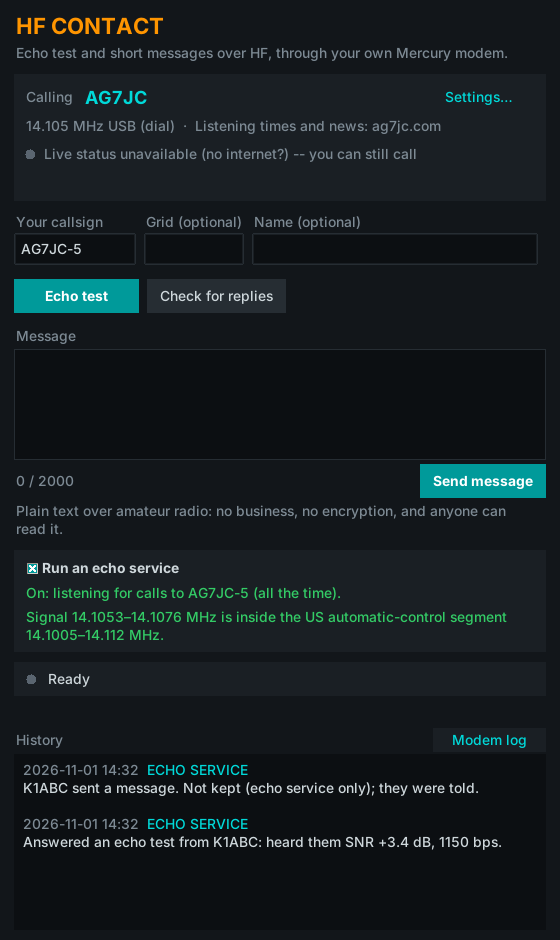
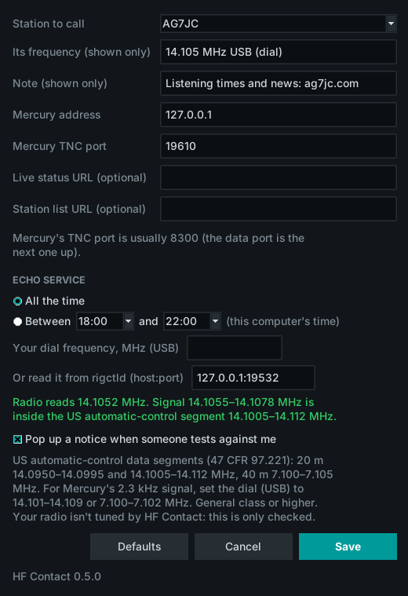

# HF Contact

[](https://github.com/Saltyhaus/hf-contact/actions/workflows/build.yml)
[](https://github.com/Saltyhaus/hf-contact/releases/latest)

Echo test and short messages to a [Mercury](https://github.com/Rhizomatica/mercury) station, over HF, through your own Mercury modem.



You already run Mercury with your radio. HF Contact uses it to call a station and:

- **Echo test**: the station answers right away, in the same call, with how it heard you (SNR and speed as its modem measured them). It's a quick "can we hear each other?" check.
- **Send a message**: a short text (2000 characters), signed with your name and grid if you add them.
- **Check for replies**: anything the operator wrote back is waiting at the station. It's sent to you the next time you call.
- **Run an echo service** (new in 0.4.0): your own station answers other people's echo tests while you're away, so there's one more station to test against.

By default it calls **AG7JC**. Settings can point it at any station running mercury-connector with guest mode (see [The other end](#the-other-end)).

## What you need

- **Mercury** running on this computer, set up with your radio's audio and PTT. **Use Mercury 1.9.20 or newer**, like the station you're calling: 1.9.20 and later all connect to each other, but not to anything older (an older station hears the calls and never connects). AG7JC keeps up with the latest release.
- **Nothing else using Mercury.** It only accepts one program at a time, so close Winlink Express, Pat or mercury-connector first.
- **Your radio on the station's frequency.** For AG7JC, that's **14.105 MHz USB (dial)**.

## Install

**Windows:** download **[HF-Contact.exe](https://github.com/Saltyhaus/hf-contact/releases/latest/download/HF-Contact.exe)** (latest release) and run it. No install, no Python needed.

> Windows may say *"Windows protected your PC"* the first time. The .exe isn't code-signed, which is normal for small open-source tools. Click **More info › Run anyway**. It's built from this repo's source by GitHub Actions; the build log is on the [Actions](https://github.com/Saltyhaus/hf-contact/actions) tab.

**Linux:** you need Python 3.9 or newer with Tk.
```
sudo apt install python3-tk          # Debian/Ubuntu, if Tk isn't there yet
git clone https://github.com/Saltyhaus/hf-contact.git && cd hf-contact
./hf-contact.py
```

To put it in your app menu with its icon: `./install.sh` (undo with `./install.sh --remove`).

## Use

1. Check the light under **Calling**. It shows whether the station is on the air right now, from the same live feed as its website. The feed only counts for the station it names, so calling someone else never shows AG7JC's light. With no internet, or for a station without a feed, it just says so, and you can still call.
   Under it, the app compares your Mercury with the station's: green if they connect (the same version, or both 1.9.20 or newer), orange if they don't. It asks the Mercury that's running on this computer, so start Mercury first. With no internet there's no comparison, and you can still call.
2. Enter your callsign. Grid and name are optional.
3. **Echo test**: it calls, sends a ping, shows the station's report on you, and hangs up.
4. **Send message**: same, with your text.
5. **Check for replies**: calls and collects anything waiting for you.

**Hang up** ends a call early. History keeps everything on this computer, and the **Modem log** shows what Mercury reported.



If the station says it's off the air or busy, or your Mercury version doesn't match the station's, the app asks before calling: once. After that the line under **Calling** keeps saying it, with no more pop-ups until something changes. For a station that doesn't publish its version, it shows yours and reminds you that both ends need the same one.

Once a day the app checks GitHub for a newer release and, if there is one, shows a quiet line with a link. No internet, nothing shown.

Mercury's TNC port is 8300 unless you changed it. If you did, set it under **Settings**, along with the live status address (the station website's hf-contact.json) if you're calling a station other than AG7JC.

## Run an echo service

Tick **Run an echo service** and your Mercury answers calls to your callsign by itself. Anyone with HF Contact (or a mercury-connector station) can call you for an echo test and get back how you heard them, in the same format AG7JC sends.



- **Echo tests only.** Messages people send aren't kept. The caller gets one short note saying so, and History notes that a message came in (not what it said).
- **Limits**, so an unattended station can't be kept on the air: 3 echo replies per call, a call is hung up after 3 minutes or after 60 seconds of nothing, and each caller gets 6 calls an hour.
- **Your own calls come first.** Press Echo test or Send message and the service pauses, then goes back to listening when you're done.
- **Hours:** under **Settings**, all the time or between two hours (this computer's time). Outside them, Mercury is left alone. The switch is always off when the app starts.
- History lists every echo it answered, with the caller's signal, and a desktop notice pops up when someone tests against you (switch it off in Settings). The notice is silent on purpose: on a radio computer the default sound card may be the radio's.
- **Off means off.** Stopping the service, pausing it or quitting the app tells Mercury to stop answering calls. If the app crashes or the computer loses power while the service is on, Mercury's listening is switched off the next time HF Contact starts.



### Where you may run it (US)

With the service on, your station transmits with nobody at the radio. In the US that's **automatic control** ([47 CFR 97.221](https://www.law.cornell.edu/cfr/text/47/97.221)): General class or higher, and only inside the automatic-control data segments, unless someone is monitoring.

| Band | Segment | Dial (USB) for Mercury's 2.3 kHz signal |
|---|---|---|
| 20 m | 14.0950–14.0995 and 14.1005–14.112 MHz | **14.101–14.109 MHz** |
| 40 m | 7.100–7.105 MHz | **7.100–7.102 MHz** |

There are segments on 80, 30, 17, 15, 12 and 10 m too. Mercury's signal sits about 0.35–2.65 kHz above the dial, so the whole of it has to fit inside a segment (14.100 itself is the beacon window, between the two 20 m segments).

Put your dial frequency in **Settings** and the app checks it. Or give it your rigctld address (e.g. `127.0.0.1:4532`) and it reads the dial from the radio every 30 seconds while the service is on, so the check follows the radio if someone retunes it. Outside a segment you get a warning, not a block: *you are running outside the automatic control segment in the US, must monitor or be in an area that allows.* Other countries have their own rules, and you may be sitting at the radio. HF Contact doesn't tune your radio; it only checks the number you give it.

## Station list

If the station you call publishes a list of stations (AG7JC's is `https://ag7jc.com/data/stations.json`), **Settings** offers them in a drop-down: pick one and its call, frequency, grid and listening hours fill in (in UTC and your own time). Each is marked **worked on air** (it has been reached over HF) or **listed** (added on request), and stations running an echo service say so. You can still type any callsign. The last list downloaded is kept, so the drop-down works in the field with no internet.

**List my station…** (in Settings) asks whoever runs the list to add your station, or take it off. It fills in your call, grid, frequency, hours (converted to UTC) and Mercury version; you tick that it's OK to show publicly. Send it **over Mercury** (one call to the list's owner) or by **Email** (or **Copy** it into any mail). It's a request: the owner checks it and adds it by hand.

```json
{"updated": "2026-11-03T18:00:00Z",
 "submit": {"call": "AG7JC", "email": "joshua@ag7jc.com"},
 "stations": [{"call": "AG7JC", "freq_mhz": 14.105, "grid": "DM12", "hours_utc": [1, 6],
               "echo_service": true, "worked": true, "last_confirmed": "2026-11-03",
               "status_url": "https://ag7jc.com/data/hf-contact.json"}]}
```

Only `call` is required. To give your own station a live light and version check in everyone's app, publish a status file like AG7JC's with your `"callsign"` in it and put its address in `status_url`.

## Log it

**Export ADIF…** above History saves your contacts for a logbook (QLog, Wavelog, Log4OM...): echo tests you ran, calls where a message or reply went through, and echo tests your service answered, with frequency, band, your grid and the signal reports. ADIF has no Mercury mode yet, so they're logged as mode `DYNAMIC` (its mode for adaptive ARQ modems like VARA) with "Mercury" in the comment. History from before 0.5.0 didn't record contacts and isn't exported.

## Good to know

- **Messages are plain text over amateur radio.** Anyone can read them. No business traffic, nothing encrypted.
- **The station limits what it accepts** from callers it doesn't know: 4 KB per message, a few messages and echo pings per call.
- **The other station may be unattended.** AG7JC listens in an automatic-control segment (FCC §97.221), which is why it's on 14.105.

## The other end

The station runs [mercury-connector](https://github.com/Rhizomatica/mercury-connector) with **guest mode** (`-g`), currently on the `multi-peer` branch of [Saltyhaus/mercury-connector-fork](https://github.com/Saltyhaus/mercury-connector-fork). With `-g`:

- a message named `echo…` is answered in the same session
- other messages go to the operator's inbox, under the callsign that actually connected
- replies placed in `<outgoing>/<CALLSIGN>/` go out when that station calls
- the connector never calls guests itself

## How it talks to Mercury

It uses the same interface as the VARA-style TNC: a text control port (`MYCALL`, `CONNECT`, `DISCONNECT`, plus status lines like `CONNECTED`, `SN`, `BITRATE`, `BUFFER`), and the data port next to it. Messages use mercury-connector's framing:

```
4-byte little-endian length | filename "\n" | payload
```

`hf_contact/tnc.py` is that layer on its own, with no user interface code, if you want to reuse it.

## Development

```
python3 -m unittest tests.test_session tests.test_mercury_version tests.test_echo_service tests.test_extras
CONNECTOR=/path/to/mercury-connector python3 -m unittest tests.test_end_to_end
```

`test_echo_service` has HF Contact call HF Contact: one fake modem runs the echo service, the other calls it the normal way. The end-to-end test runs a real mercury-connector (with `-g`) against the app, over `tests/fake_air.py`: two fake Mercury modems joined by a fake radio path.

## License

GPL-3.0-or-later, same as Mercury and mercury-connector. 73 de AG7JC.
