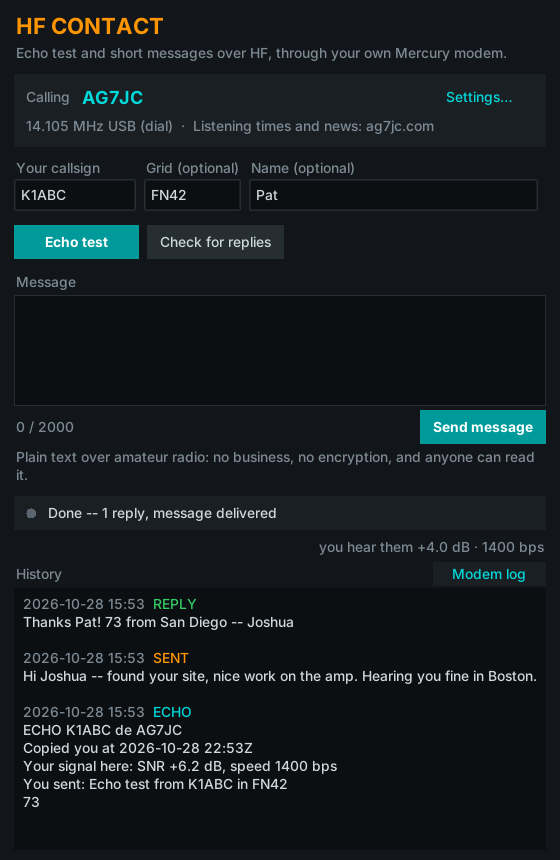

# HF Contact

Echo test and short messages to a [Mercury](https://github.com/Rhizomatica/mercury) station, over HF, through your own Mercury modem.



You already run Mercury with your radio. HF Contact uses it to call a station and:

- **Echo test**: the station answers right away, in the same call, with how it heard you (SNR and speed as its modem measured them). It's a quick "can we hear each other?" check.
- **Send a message**: a short text (2000 characters), signed with your name and grid if you add them.
- **Check for replies**: anything the operator wrote back is waiting at the station. It's sent to you the next time you call.

By default it calls **AG7JC**. Settings can point it at any station running mercury-connector with guest mode (see [The other end](#the-other-end)).

## What you need

- **Mercury** (1.9.13 or newer recommended) running on this computer, set up with your radio's audio and PTT.
- **Nothing else using Mercury.** It only accepts one program at a time, so close Winlink Express, Pat or mercury-connector first.
- **Your radio on the station's frequency.** For AG7JC, that's **14.105 MHz USB (dial)**.

## Install

**Windows:** download `HF-Contact.exe` from [Releases](../../releases) and run it. No install, no Python needed.

**Linux:** you need Python 3.9 or newer with Tk.
```
sudo apt install python3-tk          # Debian/Ubuntu, if Tk isn't there yet
git clone <this repo> && cd hf-contact
./hf-contact.py
```

## Use

1. Enter your callsign. Grid and name are optional.
2. **Echo test**: it calls, sends a ping, shows the station's report on you, and hangs up.
3. **Send message**: same, with your text.
4. **Check for replies**: calls and collects anything waiting for you.

**Hang up** ends a call early. History keeps everything on this computer, and the **Modem log** shows what Mercury reported.

Mercury's TNC port is 8300 unless you changed it. If you did, set it under **Settings**.

## Good to know

- **Messages are plain text over amateur radio.** Anyone can read them. No business traffic, nothing encrypted.
- **The station limits what it accepts** from callers it doesn't know: 4 KB per message, a few messages and echo pings per call.
- **The other station may be unattended.** AG7JC listens in an automatic-control segment (FCC §97.221), which is why it's on 14.105.

## The other end

The station runs [mercury-connector](https://github.com/Rhizomatica/mercury-connector) with **guest mode** (`-g`), currently on the `multi-peer` branch of [Saltyhaus/mercury-connector-fork](https://github.com/Saltyhaus/mercury-connector-fork). With `-g`:

- a message named `echo…` is answered in the same session
- other messages go to the operator's inbox, under the callsign that actually connected
- replies placed in `<outgoing>/<CALLSIGN>/` go out when that station calls
- the connector never calls guests itself

## How it talks to Mercury

It uses the same interface as the VARA-style TNC: a text control port (`MYCALL`, `CONNECT`, `DISCONNECT`, plus status lines like `CONNECTED`, `SN`, `BITRATE`, `BUFFER`), and the data port next to it. Messages use mercury-connector's framing:

```
4-byte little-endian length | filename "\n" | payload
```

`hf_contact/tnc.py` is that layer on its own, with no user interface code, if you want to reuse it.

## Development

```
python3 -m unittest tests.test_session
CONNECTOR=/path/to/mercury-connector python3 -m unittest tests.test_end_to_end
```

The end-to-end test runs a real mercury-connector (with `-g`) against the app, over `tests/fake_air.py`: two fake Mercury modems joined by a fake radio path.

## License

GPL-3.0-or-later, same as Mercury and mercury-connector. 73 de AG7JC.
